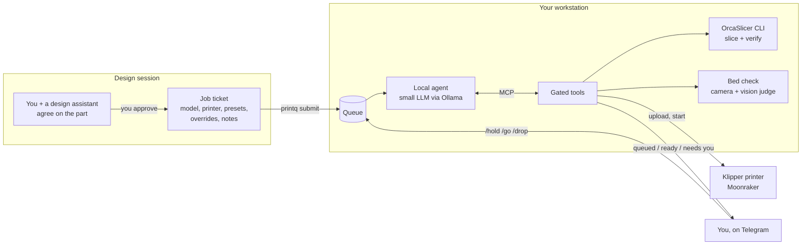

# printq

A print queue for Klipper printers in which a design session hands an approved part to a **local LLM agent**, and the agent slices it, tells you it is queued, and starts the print once the bed is clear.

The agent is a small model running on your own GPU. It is not trusted with the printer. Every action it can take is a tool with its own checks, so the worst a confused model can do is stop and ask you.



## What it does

1. **Handoff.** When you approve a design, the design session writes a *ticket*: the model file, the printer, a set of slicer presets, any per-job overrides, and free-text notes. `printq submit` validates it and puts it in the queue.
2. **Prepare.** The agent slices the model with OrcaSlicer. The slice tool reads the settings back out of the G-code and compares them with the ticket, so a preset that silently failed to apply is caught here. The agent then messages you: what is queued, OrcaSlicer's filament and time estimate, and anything worth knowing (printer busy, wrong spool).
3. **Launch.** When the printer goes idle, the queue runs the bed check. A vision model looks at the printer's camera and answers *clear*, *occupied* or *cannot tell*. Only *clear* lets the job continue to upload and start. Otherwise you are told once, and the queue looks again every five minutes until you have cleared the bed.
4. **You stay in charge.** Per printer you choose whether a clear bed starts the print at once (`auto`), starts it after a countdown you can veto from your phone (`veto`), or waits for your `/go` (`confirm`). Anything the agent cannot resolve comes to you with the bed photo attached.

A ticket can also be a *macro job*: a list of commands to run on the printer (a calibration, a PID tune) that waits its turn and passes the same gates, with nothing to slice. See [docs/tickets.md](docs/tickets.md#macro-jobs).

## Why the agent is safe to run

The interesting design question is how to let a 20-billion-parameter local model drive a machine that can crash itself. The answer here is that it does not get to decide anything that matters:

- **The agent has no shell, no files, no network.** Its only tools are the eight in [`printq/tools.py`](printq/tools.py), offered over MCP, and each phase sees only the ones it needs.
- **Each tool checks its own preconditions at the moment it runs.** `start_job` re-reads the printer's state, the age of the bed verdict, the hold flag and the loaded material, whatever the agent did or said before.
- **Jobs move through a fixed state machine.** Upload is impossible before a clear bed check; start is impossible before upload.
- **The agent's report is ignored.** After each phase the daemon looks at where the job actually ended up. If that is not a state the phase may end in, you are told.
- **The bed-clear decision is never the local model's.** It comes from a stronger vision model, and every failure of that judge (no credentials, timeout, refusal, malformed answer) counts as *cannot tell*.
- **Moving the bed into view has hard limits**: only with the toolhead proven parked clear of the bed, never past a set height, and it never homes Z.

[`tests/test_gates.py`](tests/test_gates.py) attacks each of these against a pretend printer.

## Status

Working end to end against a simulated printer, and for slicing against real preset sets. The live bed-check motion on a real machine should be supervised the first time; printers ship in `confirm` mode for that reason. See [docs/operations.md](docs/operations.md#commissioning-a-printer).

## Requirements

- Linux, Python 3.11+, [uv](https://docs.astral.sh/uv/)
- Klipper printers with Moonraker and a webcam
- [OrcaSlicer](https://github.com/OrcaSlicer/OrcaSlicer) 2.5+ and one flattened preset set per printer ([docs/tickets.md](docs/tickets.md#preset-sets))
- [Ollama](https://ollama.com) with a tool-calling model (developed with `gpt-oss:20b` on a 16 GB GPU)
- [Claude Code](https://claude.com/claude-code) as the agent harness (it is pointed at Ollama, not at Anthropic)
- A Claude API key for the bed-check judge, until you have [trained your own](docs/training-your-own-model.md)
- Optional: a Telegram bot for messages and commands, Spoolman for spool checks

## Quick start

```bash
git clone https://github.com/johncroc/printq && cd printq
uv venv && uv pip install -e .
mkdir -p ~/.config/printq
cp config/printers.example.json ~/.config/printq/printers.json   # edit
cp config/env.example ~/.config/printq/env && chmod 600 ~/.config/printq/env   # edit
.venv/bin/printq doctor            # says what is missing
.venv/bin/printq check examples/ticket.json
.venv/bin/printq daemon            # or install systemd/printq.service
```

## Documentation

| | |
|---|---|
| [Architecture](docs/architecture.md) | Components, the job state machine, the two agent phases, what each tool refuses |
| [Tickets and presets](docs/tickets.md) | The handoff format, overrides, verification, building a preset set |
| [The print desk](docs/desk.md) | The page where dropped, exported and slicer-sent files become jobs; filament grouping and the spool wait |
| [Bed check](docs/bed-check.md) | The three verdicts, the raise-and-look procedure and its limits, judges |
| [Operations](docs/operations.md) | Install, configuration, Telegram, commands, commissioning, troubleshooting |
| [Handoff from a design session](docs/handoff.md) | How an assistant submits a job, with a ready-made Claude Code skill |
| [Training your own bed-check model](docs/training-your-own-model.md) | The dataset printq collects for you and how to get from it to a local classifier |

## License

MIT. See [LICENSE](LICENSE).
