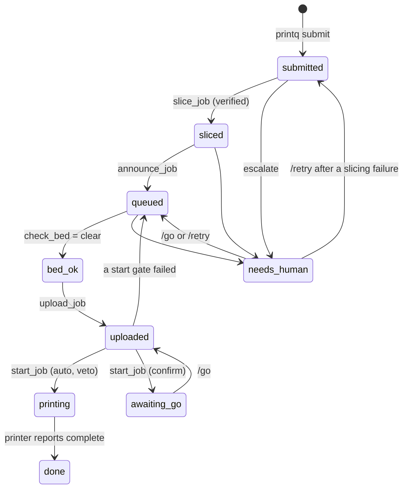

# Architecture

## Components

| Module | Role |
|---|---|
| `jobs.py` | Tickets, job directories, the state machine |
| `macro.py` | Sends a macro job's commands once it has passed the gates |
| `slicer.py` | Runs the OrcaSlicer CLI and verifies the G-code against the ticket |
| `moonraker.py` | Printer status, camera frame, upload, start; Spoolman lookup |
| `bedcheck.py` | Camera-based bed check, including moving the bed into view |
| `notify.py` | Telegram messages out, commands in |
| `tools.py` | The eight tools the agent can call. **All safety gates are here.** |
| `mcp_server.py` | Serves those tools over the Model Context Protocol (stdio) |
| `agent.py` | Starts the local agent for one phase of one job |
| `daemon.py` | The queue loop and the operator's commands |

Only `bedcheck.py` needs a third-party package (the Anthropic SDK, for the default vision judge). Everything else is the standard library.

## Job states

A job is a directory under `$PRINTQ_DATA/jobs/<id>/`:

| File | Content |
|---|---|
| `ticket.json` | The handoff, frozen at submit, with the model's SHA-256 |
| `state.json` | Current state, slice report, bed verdict, hold flag |
| `events.log` | Every transition with its time and reason |
| `slice/` | Merged presets, `plate_1.gcode`, the slicer's log |
| `agent-<phase>-<time>.json` | The agent harness's full output for each run |

## The two phases

The daemon owns the waiting; the agent only ever runs for a short, bounded task. That keeps each run inside a small model's context window and means a printer that is busy for nine hours costs nothing.

| Phase | Runs when | Tools offered | May end in |
|---|---|---|---|
| `prepare` | a job is `submitted` | `get_job`, `slice_job`, `printer_status`, `announce_job`, `escalate` | `queued`, `needs_human` |
| `launch` | a job is first in line, not held, and its printer is idle | `get_job`, `printer_status`, `check_bed`, `upload_job`, `start_job`, `escalate` | `printing`, `awaiting_go`, `needs_human`, `queued` |

The prompts are in [`prompts/`](../prompts). They describe the situation and the order of work; they do not carry the safety rules, because a prompt is a request and a gate is a guarantee.

After a run the daemon reads the job's state. If it is not in the phase's "may end in" list, the daemon itself escalates with whatever the agent last said. A launch that ends back in `queued` (printer became busy, job held) is retried after two minutes.

## What each tool refuses

| Tool | Refuses unless |
|---|---|
| `slice_job` | job is `submitted`; the model file still has the SHA-256 recorded at submit. Moves to `sliced` only if the slicer succeeded, one plate was produced, and every override and `expect` entry matches the G-code's own settings block |
| `announce_job` | job is `sliced` |
| `check_bed` | job is `queued`, not held, the printer is idle, no other job is mid-launch on that printer. Moves to `bed_ok` only on a `clear` verdict |
| `upload_job` | job is `bed_ok` |
| `start_job` | job is `uploaded`, not held; the bed verdict is `clear` and younger than `PRINTQ_BED_OK_TTL` (300 s); the printer is idle right now; the loaded spool's material matches the ticket (when Spoolman is configured). In `veto` mode all of that is checked again after the countdown |
| `escalate` | job is not already printing or finished |

A refusal is returned to the agent as text that says what state the job is in and what to do instead.

## Operator override

`/go <id>` means *I looked at the bed myself and it is clear*. It records a clear verdict attributed to the operator, valid for ten minutes, and the normal gates then apply: the printer must still be idle and the job not held. It is the only way past an `occupied` or `cannot_tell` verdict.

## The agent harness

`agent.py` runs Claude Code headless (`claude --bare -p`) with `ANTHROPIC_BASE_URL` set to the Ollama server, which implements the Anthropic Messages API. Built-in tools are switched off (`--tools ""`), only the printq MCP server is loaded (`--strict-mcp-config`), and the server is told which tools the phase may see.

Any MCP client can take its place. The tools do not depend on which model or harness is calling them, which is the point.
